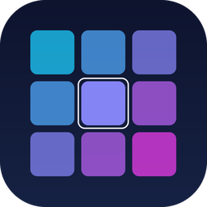

<p align="center">
  
</p>

<h1 align="center">PhotoDesk</h1>

<p align="center">
  <b>PhotoDesk di Lorenzo D'Apolito: a picture browser, in the spirit of Adobe Bridge, that opens your photos in
  <a href="https://github.com/lorenzodapolito-oss/DarkRaw">DarkRaw</a> or
  <a href="https://github.com/lorenzodapolito-oss/LightRaw.it">LightRaw</a>.</b><br>
  Written in Rust. Offline. One small program, no catalogue to build.
</p>

## What it does

- **Browse.** Folder tree (drives on Windows), shortcuts, favourites, and a thumbnail grid you can resize. Sort by name, date, size or type; search by name; drop a folder or a file on the window.
- **Raw files too.** CR2, CR3, NEF, ARW, DNG, RAF, ORF, RW2 and the other common raw formats show the JPEG preview the camera stored inside them, rotated the right way. PhotoDesk does not develop raw files: that is LightRaw's job.
- **Rate and label.** 0–5 stars (keys **0**–**5**) and five colour labels. They are saved in a small `.photodesk.json` file inside each folder; your pictures are never modified. Filter by stars or label.
- **Open with the right program.** *Automatico* sends raw files to LightRaw and everything else to DarkRaw. Or choose *DarkRaw* or *LightRaw* yourself. Double-click or **Enter** opens the selection; several files at once are passed together.
- **Keyboard.** Arrows move, **Shift**/**Ctrl** + click select several, **Ctrl+A** selects all, **F5** refreshes.

## The suite

PhotoDesk is the front door of a small suite:

| Program | Role |
|---|---|
| **PhotoDesk** | browse, rate, choose |
| **DarkRaw** | Camera Raw–style image editor |
| **LightRaw** | photo library and raw developer |

PhotoDesk looks for the other two next to itself: in folders named `DarkRaw` and `LightRaw`, or beside the program, or on `PATH`. You can also set their paths in *Impostazioni*.

## Build and run on Windows

You need Rust 1.95 or newer, a MinGW-w64 toolchain (for example [WinLibs](https://winlibs.com/)) and Git.

```powershell
git clone https://github.com/lorenzodapolito-oss/PhotoDesk
cd PhotoDesk
cargo run --release
```

### Portable suite

```powershell
cargo build --release
powershell -ExecutionPolicy Bypass -File packaging\windows\make-portable.ps1 `
  -DarkRaw  D:\path\to\DarkRaw\dist\DarkRaw-portable `
  -LightRaw D:\path\to\LightRaw.it\dist\LightRaw-portable
```

This makes `dist\PhotoDesk-portable` (and a `.zip`) with `PhotoDesk.exe`, `portable.txt`, and the `DarkRaw` and `LightRaw` folders. Copy it anywhere, even to a USB stick. Leave out `-DarkRaw` / `-LightRaw` to make PhotoDesk alone.

On Linux and macOS, `cargo run --release` works too.

## Licence

**MIT OR Apache-2.0** (see `LICENSE-MIT` and `LICENSE-APACHE`). The icon is original artwork drawn for this project. PhotoDesk is an independent project, not affiliated with or endorsed by Adobe; the comparison to Bridge only describes the kind of program it is.
